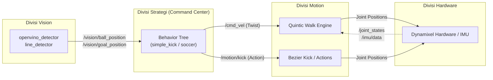

# Panduan Pembagian Tugas Tim Robot Altair (Team Task Division Guide)

Dokumen ini adalah acuan resmi pembagian peran, kepemilikan folder (*Folder Ownership*), kontrak antarmuka ROS 2 (*Interface Contracts*), dan alur kerja Git agar seluruh anggota tim dapat bekerja secara paralel tanpa saling bertabrakan (*merge conflict*).

---

## 1. Matriks Divisi & Folder Ownership

Workspace `altair_ws_fix` dibagi menjadi **5 Divisi Kerja** independen:

| Divisi | Tanggung Jawab Utama | Folder Resmi (Ownership) | Output / Kontrak Utama |
| :--- | :--- | :--- | :--- |
| **👁️ Vision & AI** | Kamera, deteksi bola/gawang/garis/rintangan, model OpenVINO, kalibrasi IPM. | `src/altair_vision/`<br>`src/altair_vision_deeplearning/`<br>`models/` (model mentah/training) | `/vision/ball_position`<br>`/vision/goal_position`<br>`/vision/annotated_frame` |
| **🏃 Motion & Kontrol** | Engine berjalan (Quintic walk), kestabilan gait, Inverse Kinematics, tendangan dinamis, animasi bangun tidur. | `src/altair_motion/` (`quintic_walk`, `bezier_kick`, `op3_action_module`, dll.) | Menerima `/cmd_vel`<br>Menerima `/motion/kick`<br>Publish `/motion/joint_commands` |
| **🧠 Strategi & Behavior** | Logika pertandingan, Behavior Tree, state machine lomba, komunikasi GameController, koordinasi tim. | `src/a_command_center/`<br>`src/altair_misc/game_controller/` | Membaca `/vision/*`<br>Mengirim `/cmd_vel` & aksi tendang ke Motion |
| **🦾 Hardware & Kalibrasi** | Komunikasi Dynamixel (U2D2), IMU sensor, mikrokontroler STM32, kalibrasi zero offset tiap robot fisik. | `src/altair_hardware/`<br>`src/altair_framework/`<br>`src/altair_data/config/robots/`<br>`src/altair_tools/` | `/joint_states`<br>`/imu/data`<br>Offset per unit robot |
| **🚀 Bringup & Integrasi** | Orkestrasi master launch, konfigurasi cabang lomba, runner lapangan (`start_lomba`), jaringan DDS multi-robot. | `src/altair_bringup/`<br>`start_lomba.py` / `start_lomba.sh`<br>`cyclone_dds.xml` | Menjamin seluruh sistem menyala dalam 1 pintu per lomba |

---

## 2. Kontrak Komunikasi Antar-Divisi (Interface Contract)

Untuk mencegah ketergantungan erat (*tight coupling*), setiap divisi **HANYA** berkomunikasi melalui topik standar ROS 2 berikut:



### Aturan Batasan (Boundary Rules):
1. **Divisi Strategi TIDAK BOLEH** mengakses kamera langsung. Strategi hanya membaca koordinat dari topik `/vision/...`.
2. **Divisi Vision TIDAK BOLEH** mengatur kecepatan motor secara langsung. Vision hanya melaporkan objek yang dilihat.
3. **Divisi Motion HANYA** bertugas menerjemahkan perintah `/cmd_vel` (arah gerak) dan `/motion/kick` (tendangan) menjadi pergerakan motor yang stabil.

---

## 3. Alur Pengujian Mandiri per Divisi (Isolated Testing)

Setiap anggota tim dapat menguji kodenya tanpa harus menunggu robot fisik utuh dinyalakan:

- **Pengujian Divisi Vision (Tanpa menyalakan motor):**
  ```bash
  python3 test_altair_vision.py --device /dev/video2 --mode penalty_kick
  ```
- **Pengujian Divisi Motion & Strategi (Simulasi / Mock Mode tanpa Hardware):**
  ```bash
  python3 configure.py -m mock
  ros2 launch a_command_center execute_motion.launch.py
  ```
- **Pengujian Divisi Hardware (Cek Kesehatan 20 Servo Dynamixel):**
  ```bash
  python3 dxl_check.py
  ```

---

## 4. Standar Alur Kerja Git (Git Branching per Divisi)

Agar tidak terjadi bentrok commit saat lomba atau latihan:

1. **Format Nama Branch:**
   - `vision/<nama-fitur>` — contoh: `vision/openvino-ball-track`
   - `motion/<nama-fitur>` — contoh: `motion/sprint-fast-gait`
   - `strategy/<nama-fitur>` — contoh: `strategy/goalie-dive-behavior`
   - `hardware/<nama-fitur>` — contoh: `hardware/dynamixel-baudrate-fix`
   - `bringup/<nama-fitur>` — contoh: `bringup/multi-robot-launcher`

2. **Aturan Pengeditan File:**
   - Hanya edit file di dalam folder milik divisi Anda.
   - Jika membutuhkan perubahan antarmuka topik bersama, buat usulan di package `src/altair_msgs/` dan diskusikan bersama tim Integrasi.
